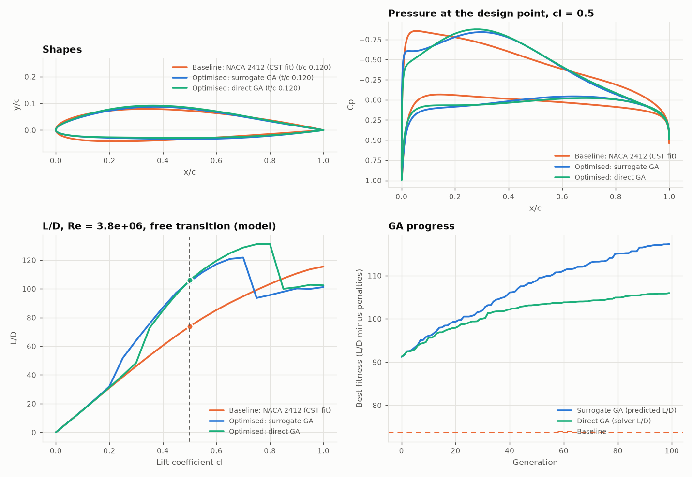
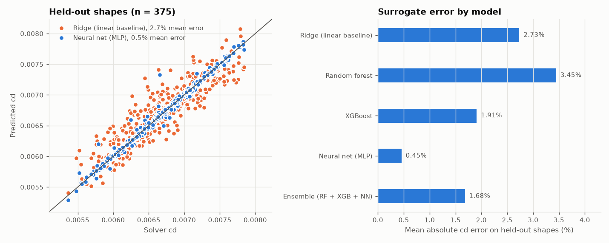
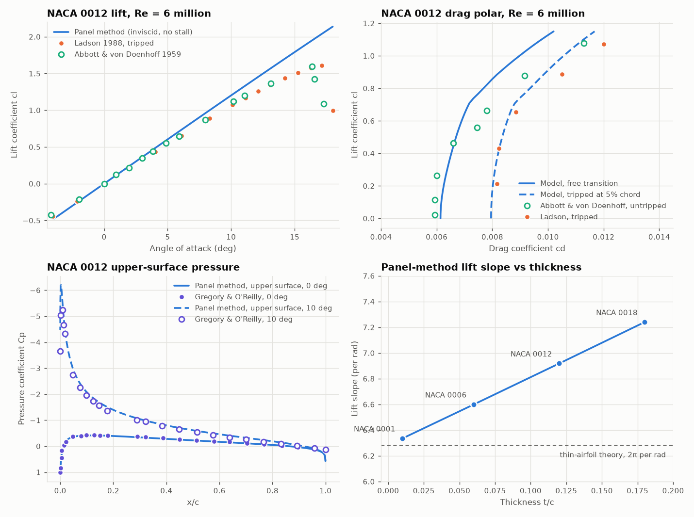
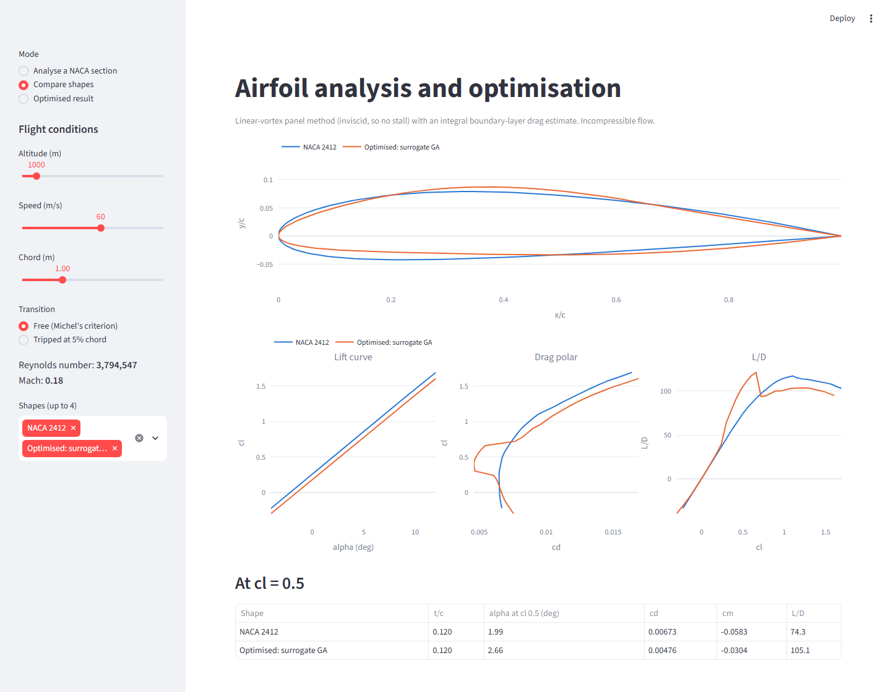

# Airfoil Shape Optimisation with a Panel Method and ML Surrogates

This project searches for 2D wing sections with a better lift-to-drag ratio (L/D) than a NACA 2412. A vortex panel method and a boundary-layer drag estimate score each shape, machine-learning surrogates learn those scores from 2,500 sampled shapes, and a genetic algorithm searches the shape space under thickness and pitching-moment limits. It is a small, checked example of surrogate-based design for engineers and ML practitioners. The physics is low-fidelity, and this README says where it stops being trustworthy.



## Results

All numbers below come from `python main_pipeline.py` (seed 0) and are stored in [docs/results.json](docs/results.json).

**Design problem.** Maximise L/D at a lift coefficient of 0.5 and Reynolds number 3.79 million (1,000 m altitude, 60 m/s, 1 m chord; Mach 0.18, treated as incompressible). The shape is 12 CST weights, each free to move by up to 0.05 from a fit of the NACA 2412. Limits: thickness at least 12% of chord, thickness at 90% chord at least 2%, quarter-chord moment cm at least -0.08, and no predicted turbulent separation.

**Baseline.** The CST fit of the NACA 2412. The exact NACA 2412 geometry scores L/D 74.3 under the same model, so the fit costs 0.8%.

| Shape | L/D, free transition | Change | L/D, tripped at 5% chord | Change | cd | cm | t/c | Upper-surface transition |
|---|---|---|---|---|---|---|---|---|
| Baseline: NACA 2412 (CST fit) | 73.7 | | 54.9 | | 0.00678 | -0.058 | 0.120 | 26% chord |
| Optimised, surrogate GA | 105.1 | +42.5% | 53.9 | -1.8% | 0.00476 | -0.030 | 0.120 | 42% chord |
| Optimised, GA on the solver | 106.0 | +43.7% | 53.5 | -2.4% | 0.00472 | -0.038 | 0.120 | 42% chord |

**What the gain means.** Under the model, the optimised section has 42% higher L/D than the baseline at the design point. All of that gain comes from laminar flow. The optimiser moved the upper-surface pressure minimum back from about 5% to about 30% chord, so the model's transition rule (Michel's criterion) keeps the upper boundary layer laminar to 42% chord instead of 26% (and the lower one to 81% instead of 43%). With transition forced at 5% chord, the optimised shape is 1.8% worse than the baseline. The low-drag range is also narrow: L/D drops sharply above a cl of about 0.7 to 0.8, where transition jumps forward (lower-left plot). Treat the gain as a lead to test with a better transition model (for example XFOIL's e^N method) or in a wind tunnel, not as a proven result.

**Shape checks.** The optimised shape keeps 12.0% thickness (the limit is active) and 2.8% thickness at 90% chord, its surfaces do not cross, and the solver finds no turbulent separation at the design point. Its nose is sharper: the smaller of the two CST leading-edge radii is 0.52% of chord against 1.15% for the baseline, which is normal for laminar-flow sections. Coordinates are in [docs/optimised_airfoil.dat](docs/optimised_airfoil.dat).

### Surrogate accuracy on held-out shapes

Each row of data is one shape, so the 70/15/15 split is a split by shape and no test shape is seen during training. The validation set picks the model; the test set (375 shapes) is used only for the numbers below.

| Model | cd mean abs. error | cd R² | alpha error (deg) | cm error | Training time |
|---|---|---|---|---|---|
| Ridge regression (linear baseline) | 2.73% | 0.791 | 0.0020 | 0.00007 | under 0.1 s |
| Random forest | 3.45% | 0.700 | 0.126 | 0.0041 | 2.5 s |
| XGBoost | 1.91% | 0.882 | 0.047 | 0.0014 | 1.9 s |
| **Neural net (12-64-64-3 MLP), chosen** | **0.45%** | **0.986** | **0.0026** | **0.00008** | 37 s |
| Ensemble of RF, XGBoost and MLP | 1.68% | 0.918 | 0.055 | 0.0017 | (sum of the three) |

The targets are smooth functions of the weights, so the tree models do worse than a straight linear fit on alpha and cm, and averaging them into an ensemble makes the MLP worse, not better.

The average error hides a larger miss at the optimum. For the shape the surrogate GA liked best, the surrogate predicted L/D 117.3 and the solver gave 105.1, so the surrogate was 12% too high. An optimiser seeks out the shapes where the surrogate errs in its favour, so the pipeline re-scores the 20 best surrogate picks with the solver and keeps the best one that meets every limit.



### Speed

| Step | Time |
|---|---|
| Solver, one shape (one core) | 7.6 ms |
| MLP surrogate, one shape per call | 0.49 ms (15 times faster) |
| MLP surrogate, per shape in a batch of 60 | 0.0095 ms (800 times faster) |
| Surrogate route end to end: score 2,500 shapes (16 s on 2 cores), train all four models (41 s), run the GA (5,460 calls, 0.5 s), re-score 20 picks (0.2 s) | 58 s |
| GA with the solver in the loop (5,460 calls, 2 cores) | 31 s |

Timings come from one run on a shared machine limited to 2 worker processes; across three runs they varied by up to about 20%. The surrogate is fast per call, but with a solver this cheap the direct GA finished sooner and found a slightly better shape. A surrogate pays off when each solver call takes seconds or more (for example RANS CFD), or when one trained surrogate serves many design studies.

## Validation

`python validate.py` checks the aerodynamic model against theory and NACA 0012 wind-tunnel data, and writes [docs/validation.json](docs/validation.json).



| Check | Model | Reference |
|---|---|---|
| Lift against the exact Karman-Trefftz solution, 160 panels, 5 deg | -0.03% error (-0.44% at 40 panels, -0.008% at 320) | exact potential flow |
| Lift slope of a thin section, NACA 0001 | 6.335 per rad | 2π = 6.283 per rad, thin-airfoil theory |
| NACA 0012 lift at 0 deg | -2e-15 | 0, by symmetry |
| NACA 2412 zero-lift angle | -2.15 deg | -2.08 deg, thin-airfoil theory (negative for positive camber) |
| NACA 0012 lift slope, Re 6 million | 0.121 per deg | 0.107 per deg, Ladson (1988), fit over -4 to 10 deg |
| NACA 0012 cd, transition tripped at 5% chord, 0 to 10 deg | 3.3% mean abs. error | Ladson (1988), tripped |
| NACA 0012 cd, free transition, cl 0 to 0.88 | 6.1% mean abs. error | Abbott and von Doenhoff (1959), untripped |

Point by point against Ladson's tripped data (drag compared at the measured cl):

| alpha (deg) | cl measured | cl panel method | cd measured | cd model |
|---|---|---|---|---|
| 0.0 | -0.013 | -0.006 | 0.00809 | 0.00795 |
| 2.1 | 0.213 | 0.247 | 0.00816 | 0.00803 |
| 4.0 | 0.432 | 0.487 | 0.00823 | 0.00825 |
| 6.1 | 0.655 | 0.734 | 0.00885 | 0.00865 |
| 8.3 | 0.887 | 0.999 | 0.01050 | 0.00986 |
| 10.1 | 1.071 | 1.216 | 0.01201 | 0.01106 |

The panel method is inviscid. It over-predicts the lift slope by about 12% against the measurements, and it does not predict stall: its lift keeps rising past the measured maximum near 16 to 17 degrees. Do not use it for maximum lift. The thicker the section, the further its lift slope sits above 2π, as potential-flow theory predicts (lower-right plot).

## How it works

1. **Geometry** (`utils/parameterization.py`). NACA 4-digit sections from the standard formulas, with a closed trailing edge. Shapes for optimisation use CST (Kulfan): a round-nose class function times a 5th-order Bernstein polynomial, so 6 weights per surface. The NACA 2412 fit has an RMS error of 0.0002 chord.
2. **Panel method** (`simulation/aerodynamics.py`). Linear-strength vortex panels (160 panels, cosine spacing), flow tangency at panel midpoints and a Kutta condition at the trailing edge. Each shape needs one LU factorisation; solutions at 0 and 90 degrees are superposed, so the angle that gives a target cl comes out in closed form. Lift comes from the circulation and moment from integrating the pressure.
3. **Drag estimate** (`simulation/boundary_layer.py`). This is an approximation. Starting from the stagnation point it marches Thwaites' method (laminar), switches to turbulent at Michel's criterion, a trip, or laminar separation, marches Head's method (turbulent, Ludwieg-Tillmann skin friction), and applies the Squire-Young formula. The boundary layer does not feed back into the pressure field. The march stops at 98% chord, because the inviscid speed falls to zero at a sharp trailing edge, which a real boundary layer never sees; moving that point to 99% changes NACA 0012 cd by about 1%.
4. **Data and surrogates** (`optimization/problem.py`, `models/surrogate.py`). 2,500 Latin hypercube samples of the 12 weights, each scored at the design cl. The surrogates predict cd, alpha and cm from the weights. Scalers are fitted on the training rows only. The MLP uses SiLU activations, Adam, and early stopping on the validation set.
5. **Optimiser** (`optimization/algorithms.py`). A real-coded genetic algorithm (tournament selection, simulated binary crossover, polynomial mutation, 10% elitism), population 60 for 100 generations, with the baseline in the first population. Broken limits subtract a penalty from L/D. Thickness is checked on the exact geometry; cm comes from the surrogate and is re-checked by the solver.

## How to run

Tested with Python 3.12 on Windows 11 (numpy 2.5, torch 2.14, xgboost 3.4, scikit-learn 1.9, streamlit 1.66).

```bash
python -m venv .venv
source .venv/bin/activate          # Windows: .venv\Scripts\activate
pip install -r requirements.txt

pytest                             # 10 quick checks of the maths, a few seconds
python validate.py                 # downloads the NACA 0012 data, writes docs/validation.*
python main_pipeline.py            # about 2 minutes on 2 cores; --quick runs a 1-minute smoke test into data/quick/
streamlit run visualization/dashboard.py
```

`main_pipeline.py` writes `docs/results.json`, `docs/optimisation.png`, `docs/surrogate.png` and `docs/optimised_airfoil.dat`. The sampled data (`data/`) and the trained model (`models/surrogate_model.pkl`) stay out of git.

The dashboard analyses any NACA 4-digit section at a chosen speed, altitude and chord, compares sections side by side, and shows the optimised result from `docs/results.json`.



## Data and references

**Wind-tunnel data.** From the NASA Langley Turbulence Modeling Resource page "2D NACA 0012 Airfoil Validation Case" (https://turbmodels.larc.nasa.gov/naca0012_val.html). Downloaded on 23 October 2026 from the Internet Archive copy of that page's files, because the NASA server did not respond. `validate.py` tries NASA first, then the archive, and saves the files to `data/validation/`. They are not stored in this repo: the page gives no licence, and two of the sets are digitised from a book and a UK report under their own copyright.

- `CLCD_Ladson_expdata.dat`: C. L. Ladson, NASA TM 4074 (1988). Re 6 million, Mach 0.15, transition tripped (80-grit set used here).
- `0012.abbottdata.cl.dat`, `0012.abbottdata.cd.dat`: digitised from I. H. Abbott and A. E. von Doenhoff, *Theory of Wing Sections*, Dover (1959). Re 6 million, not tripped.
- `CP_Gregory_expdata.dat`: N. Gregory and C. L. O'Reilly, ARC R&M 3726 (1970). Re 2.88 million, upper surface only.

**Methods.**

- J. Katz and A. Plotkin, *Low-Speed Aerodynamics*, 2nd ed., Cambridge University Press (2001), chapter 11: linear-strength vortex panels.
- B. Thwaites (1949), laminar boundary layer; R. Michel (1951), transition; M. R. Head (1958), turbulent entrainment method; H. Ludwieg and W. Tillmann (1949), skin friction; H. B. Squire and A. D. Young (1938), profile drag. Correlations as given in T. Cebeci and P. Bradshaw, *Momentum Transfer in Boundary Layers* (1977).
- B. M. Kulfan, "Universal parametric geometry representation method", *Journal of Aircraft* 45(1), 2008: CST.
- K. Deb and R. B. Agrawal (1995): simulated binary crossover.

## Limits and next steps

- **No stall, no viscous lift loss.** The panel method is inviscid: lift slope is about 12% high against data and there is no maximum lift. The boundary layer does not change the pressure field.
- **The drag model is rough.** Michel's criterion is a crude transition rule, laminar separation bubbles are not modelled (laminar separation just triggers transition), and drag is 3% to 6% off on average for the NACA 0012 but 11% low at cl 0.88 with free transition.
- **The optimisation gain rests on laminar flow.** The next step is to check the optimised shape with an e^N transition model (XFOIL) and to optimise over several lift coefficients so the low-drag range is wider.
- **Surrogate optimism.** The surrogate over-predicted L/D at its optimum by 12%. Adding the solver-checked picks to the training set and retraining for a few rounds (adaptive sampling) would shrink this.
- **Scope.** Incompressible, 2D, one design point, and the surrogate is only valid inside the sampled weight box.

## Project structure

```
utils/parameterization.py      NACA 4-digit and CST geometry, geometry checks
simulation/aerodynamics.py     vortex panel method, simulator, standard atmosphere
simulation/boundary_layer.py   integral boundary layer and drag estimate
optimization/problem.py        design variables, limits, sampling, fitness
optimization/algorithms.py     genetic algorithm
models/surrogate.py            ridge, random forest, XGBoost, MLP and ensemble surrogates
validate.py                    checks against theory and wind-tunnel data
main_pipeline.py               sampling, training, optimisation, figures
visualization/dashboard.py     Streamlit app
tests/                         pytest checks
```

## Author

Tiiso Letsapa, Letsapamyron07@gmail.com

MIT License, see [LICENSE](LICENSE).
